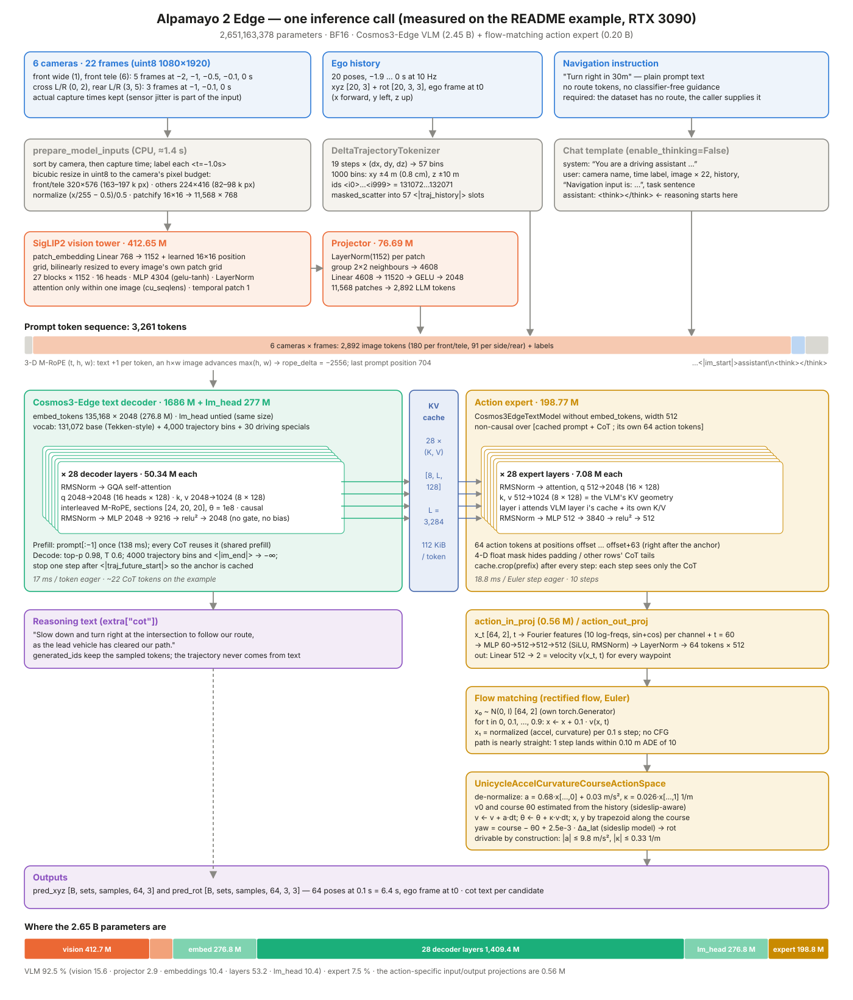

# Figures

Open this file with **Ctrl+Shift+V** (VS Code markdown preview) to see every figure inline.
Each figure names the launch config that regenerates it.

## Demo videos (4a–4c, `study/outputs/videos/`)

All 1920×1080 H.264. The drive-alongs run one inference every 0.1 s of the clip (10 fps =
real time), six candidates each, `--accel tuned`; inputs at every tick are built by the
repository's own loader and `prepare_model_inputs`. The route is an oracle sentence
re-derived at each tick from the logged path.

| video | what it shows |
|---|---|
| [`drive_ea7bbd31.mp4`](outputs/videos/drive_ea7bbd31.mp4) | the README intersection at night: `<NOMINAL>` on the approach → "slow down and turn right" → "yield to the crossing vehicle from the right" → the turn → `<NOMINAL>` again |
| [`drive_030c760c.mp4`](outputs/videos/drive_030c760c.mp4) | Alpamayo 1.5's test clip in daylight: "shift left within our lane … passing the construction equipment and workers on the right", following a braking lead car, "steer right to return to our lane after clearing the parked truck" |
| [`drive_8d82d3c7.mp4`](outputs/videos/drive_8d82d3c7.mp4) | a roundabout: note the CoT flipping between "second exit" and "third exit" from one 0.1 s tick to the next |
| [`route_ea7bbd31.mp4`](outputs/videos/route_ea7bbd31.mp4) | the same ticks with the oracle route and with left/right swapped, side by side; once the car is committed to the right turn (t0 ≥ 10 s) the swapped run says "turn right" too |
| [`flow_ea7bbd31.mp4`](outputs/videos/flow_ea7bbd31.mp4) | six candidates denoised from noise to plans over the 10 Euler steps |

VS Code's preview plays the `<video>` tags below; the stills are frames from each video.

<video src="outputs/videos/drive_ea7bbd31.mp4" controls width="960"></video>

<video src="outputs/videos/drive_030c760c.mp4" controls width="960"></video>

<video src="outputs/videos/drive_8d82d3c7.mp4" controls width="960"></video>

<video src="outputs/videos/route_ea7bbd31.mp4" controls width="960"></video>

<video src="outputs/videos/flow_ea7bbd31.mp4" controls width="960"></video>

## Architecture (3-9, from `outputs/anatomy.json`)

## The 22 camera inputs (3-1)

## Six candidates vs the logged path, and where diversity comes from (3-1)

Left: six independent CoTs. Right: one fixed CoT, six diffusion noise seeds.

## Action space: round trip of the logged right turn, and the controls (3-5a)

## Flow matching: noise → plan in 10 Euler steps (3-5b)

## Route ablation: same scene, four route sentences (3-6a)

## 21-clip evaluation, oracle route (3-7a)

## Same clips, wrong route "Turn right in 30m" everywhere (3-7b)

## Reasoning-tampering study (3-5c … 3-5f, [09](09_REASONING_ACTION_STUDY.md))

Forced reasoning, everything else fixed (route "Turn right in 30m"):

Route sentence (panels) × forced reasoning (colours):

Speed words and the stop split, planned speed over 6.4 s:

## How much the reasoning helps: 21 clips, reasoning removed (3-5h, [09 §7](09_REASONING_ACTION_STUDY.md))

Paired per clip (below the diagonal = the model's own reasoning beat the forced one), and the
8 clips where the model reasoned:

## Where the flow-matching expert looks (3-5g, [08](08_EXPERT_ATTENTION.md))

## RL in miniature: imitation vs reward training (3-10, [11](11_RL_EXPLAINED.md))

## Edge vs Alpamayo 1.5 on the same clips (3-7c)

Paired scatter (below the diagonal = Edge better on that clip) and route sensitivity.

Per clip, oracle route: Edge blue, Alpamayo 1.5 orange, logged future dashed.

## The upstream notebook, executed (2a)

